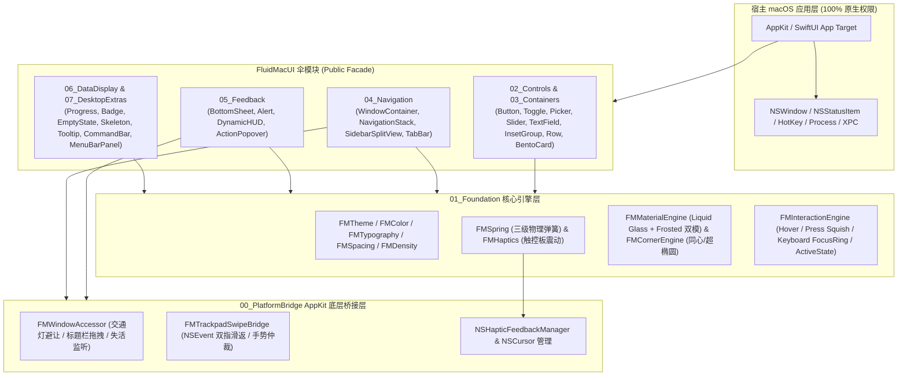
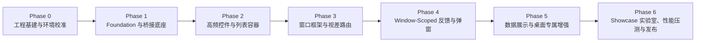

# 📘 `FluidMacUI`：深度调研分析、需求重构与研发实施方案

> **文档状态**：方案评审版（v2.0）  
> **组件库名称**：`FluidMacUI`（统一替代原草案中的 `TouchUIKit` / `TU`）  
> **核心定位**：面向原生 macOS（AppKit 宿主 + SwiftUI 声明式渲染）的**流体动效与 iOS 现代质感设计系统**——兼具 iOS/iPadOS 的物理弹性与 Liquid Glass 光学美学，以及 macOS 满血底层能力与桌面级键鼠生产力。

---

## 一、 深度调研与原方案关键诊断

在正式进入架构设计前，我们结合当前本地研发环境实测、Apple macOS 26+ SwiftUI 平台演进（Liquid Glass / Concentric Corner / Swift 6.2 并发模型）以及开源 macOS SwiftUI 设计系统（如 Luminare、Pow 等）的实践经验，对初步方案进行了系统性审计。

### 1.1 本地研发环境实测核验
| 检查项 | 实测结果 | 工程影响与前置动作 |
| :--- | :--- | :--- |
| **宿主操作系统** | `macOS 27.2.1` (ARM64) / SDK `27.2` | 完整具备 macOS 26+ 最新 SwiftUI 渲染能力，可直接运行验证 Liquid Glass 与同心圆角 |
| **Swift 工具链** | `Apple Swift 6.4.2` | 原生支持 `swift-tools-version: 6.2` 及 `.defaultIsolation(MainActor.self)` |
| **Xcode 状态** | `/Applications/Xcode.app` 已安装，但 `xcode-select` 当前指向 `CommandLineTools` | **Phase 0 前置动作**：切换 `xcode-select` 至 Xcode.app，以支持 `#Preview`、DocC 构建及 macOS App Target 调试 |

### 1.2 原方案的 8 大核心盲区与修正方向

> [!IMPORTANT]
> 原草案的视觉方向非常清晰，但存在**版本自相矛盾、未利用 macOS 26 平台代差能力、过度照搬移动端而忽略桌面端人机工程学、以及多窗口架构缺陷**等 8 个关键隐患，必须在开工前解决。

| 编号 | 原方案隐患 / 盲区 | 深度分析 | `FluidMacUI` v2.0 解决方案 |
| :---: | :--- | :--- | :--- |
| **1** | **品牌与命名残留割裂** | 标题改成了 `FluidMacUI`，但正文、前缀（`TU`）、目录（`TouchUIKit`）和示例代码仍混用旧名 | 全库彻底统一为 **`FluidMacUI`**；类型前缀采用 **`FM`**，Modifier / Style 采用 **`.fm*`** 点语法语义命名 |
| **2** | **最低系统版本前后冲突** | 1.2 节要求 `macOS 26.0`，但 4 节 `Package.swift` 和 Phase 1 却写 `macOS 14.0+` | 明确**原生优先（`macOS 26.0+`）**或**双轨兼容（`macOS 15.0+` 基线 + `macOS 26.0+` Liquid Glass 增强）**策略（推荐锁定 `macOS 26.0+` 或 `15.0+` 分层降级，见文末决策确认） |
| **3** | **未拥抱 macOS 26 Liquid Glass 与同心圆角** | 原稿仅用 `.ultraThinMaterial` + 固定 `0.5pt` 描边“手工模拟毛玻璃”，且圆角半径硬编码 | 引入 `FMMaterialEngine` 与 `FMCornerEngine`：在 macOS 26+ 原生接入 `.glassEffect()`、`GlassEffectContainer` 流体融合及 `ConcentricRectangle` 自动同心曲率，同时提供经典 `frosted` 风格及无障碍降级 |
| **4** | **“一刀切”剥离焦点框破坏键盘与无障碍体验** | 全局 `.focusEffectDisabled()` 会让 `Tab` 键盘导航用户完全丧失焦点定位，违背 macOS 专业工具习惯 | 设计 **`FMFocusRingModifier`**：隐藏原生生硬蓝框，仅在**键盘焦点进入**时渲染贴合超椭圆/同心圆角曲率的柔和主题光环（鼠标点击不干扰视觉） |
| **5** | **缺失 macOS 桌面态核心维度** | 忽略了多窗口失活态（`controlActiveState == .inactive`）、触控板双指滑返、Force Touch 物理震动、窗口拖拽区与交通灯安全区 | 建立 **macOS 桌面态规范**：失活窗口自动降噪去饱和；AppKit 桥接 `NSEvent` 触控板连续滑返；引入 `FMHaptics` 震动反馈；内置窗口标题栏拖拽区与交通灯避让算法 |
| **6** | **全局单例 HUD 在多窗口下必然串台** | `TUDynamicHUD.shared` 为进程单例，macOS 多窗口应用中会弹错窗口或全窗口齐弹 | 全面升级为 **Window-Scoped 协调器架构**（`@Environment(\.fmOverlay)`），每个 `FMWindowContainer` 拥有独立 HUD / Sheet / Alert / Popover 调度队列 |
| **7** | **单一尺寸密度难以适配多样桌面场景** | iOS 原生 51×31 开关和 44pt 列表行在主窗口舒适，但在检查器（Inspector）或菜单栏小窗（MenuBar）中过于臃肿 | 引入环境级密度令牌 `.fmDensity(.compact \| .regular \| .comfortable)`，一套组件无缝适配大屏仪表盘、侧边检查器与状态栏弹窗 |
| **8** | **缺乏性能治理、测试与工程化闭环** | 多层模糊 + 弥散动态背景易在窗口缩放/大列表滚动时掉帧；缺少单元测试、快照测试与组件实验室 | 设立 GPU 渲染性能红线（失活暂停动效、MeshGradient/Shader 降频、尊重系统无障碍开关）；配套 `Swift Testing` 状态机测试 + `FluidMacShowcase` 交互调参实验室 |

---

## 二、 完善后的需求体系与核心目标

### 2.1 产品愿景与四大设计支柱
1. **iOS 级物理生命力（Fluid Physics）**：三级弹簧曲线 + 触控板 Force Touch 触觉反馈（`FMHaptics`）+ 按压微形变（Press Squish）+ 几何连续匹配（`matchedGeometryEffect` / `glassEffectID`）。
2. **Liquid Glass 现代光学体系（Adaptive Optical Surface）**：充分利用 macOS 26+ 实时折射玻璃与同心圆角曲率，同时兼顾浅色/深色、高对比度与“降低透明度”下的极高可读性。
3. **满血桌面生产力（Mac-Native Ergonomics）**：完整保留原生 macOS 能力（`NSWindow`、`NSStatusItem`、全局热键、XPC/Process、无障碍树），原生支持悬停态、快捷键、触控板双指导航、右键上下文菜单与多窗口隔离。
4. **声明式零心智负担（Idiomatic SwiftUI API）**：严格遵循 SwiftUI Style 协议（`ButtonStyle`、`ToggleStyle`）与 Environment 注入范式，Swift 6.2 严格并发零警告，开箱即用且支持主题深度定制。

### 2.2 命名规范与 API 风格约定
* **Package / Module 名**：`FluidMacUI`
* **公开类型前缀**：`FM`（如 `FMTheme`、`FMSpring`、`FMNavigationStack`、`FMDynamicHUD`、`FMWindowContainer`）
* **Style 静态工厂**：`.buttonStyle(.fmPrimary)` / `.buttonStyle(.fm(.tinted, size: .compact))`、`.toggleStyle(.fmSwitch)`、`.toggleStyle(.fmCheckbox)`
* **ViewModifier 扩展**：`.fmBottomSheet(...)`、`.fmAlert(...)`、`.fmPopover(...)`、`.fmSkeleton(isLoading:)`、`.fmFocusRing(...)`、`.fmDensity(...)`、`.fmTheme(...)`
* **Environment 动作**：`@Environment(\.fmHUD) var hud`、`@Environment(\.fmNavigator) var navigator`

### 2.3 非功能性需求与量化验收目标 (NFR)

| 维度 | 目标要求 | 量化验收标准 |
| :--- | :--- | :--- |
| **流畅度与渲染性能** | ProMotion 高刷稳定，窗口缩放与滚动无明显掉帧 | 常规交互与页面推入稳定 **60~120 fps**；窗口失活/最小化时动态光斑背景 GPU 占用降至 **0%** |
| **并发与代码质量** | Swift 6.2+ 严格并发安全（Strict Concurrency） | 启用 `.defaultIsolation(MainActor.self)`，全库编译 **0 Errors / 0 Warnings**，无 `@unchecked Sendable` 滥用 |
| **无障碍与系统偏好** | 符合 macOS VoiceOver 与辅助功能规范 | 100% 交互控件支持 `Tab` 键盘聚焦、VoiceOver 语义角色；完整响应 `Reduce Motion`、`Reduce Transparency`、`Increase Contrast` |
| **桌面窗口完整性** | 完整适配多窗口、全屏、深浅色与失活态 | 2 个以上独立窗口并存时 HUD/Sheet/Navigation 状态完全隔离；失活窗口视觉自动降饱和 |
| **API 易用性与文档** | 接入成本极低、文档与示例完备 | 全部 Public API 含 DocC 注释；`FluidMacShowcase` 覆盖 100% 组件的交互演示与代码片段 |

---

## 三、 升级版技术架构设计

### 3.1 分层架构蓝图



### 3.2 六大核心底层引擎规格

#### 1. 光学材质与同心圆角引擎 (`FMMaterialEngine` & `FMCornerEngine`)
* **材质模式（`FMGlassStyle`）**：
  * `.liquidGlass`（macOS 26+ 默认）：调用原生 `.glassEffect(.regular / .clear / .tinted / .interactive, in: shape)`，相邻悬浮控件（如 `FMTabBar`、`FMSidebarSplitView`、`FMDynamicHUD`）由 `GlassEffectContainer` 统一包裹并绑定 `glassEffectID`，实现 Apple 原生流体融合与折射透镜效果。
  * `.frosted`（经典磨砂玻璃 / 低版本回退）：`.ultraThinMaterial` / `.regularMaterial` + `0.5pt` 动态内高光描边（深色模式白光 `0.14`，浅色模式黑边 `0.06`）+ 大半径低饱和弥散阴影。
  * **无障碍自动降级**：当检测到 `accessibilityReduceTransparency == true` 时，自动切换为高对比度不透明语义表面色 `FMTheme.elevatedOpaqueSurface`。
* **同心超椭圆圆角引擎（`FMCornerEngine`）**：
  * 外层容器使用超椭圆曲率（`RoundedRectangle(cornerRadius:, style: .continuous)`），嵌套内层卡片/按钮优先使用 macOS 26 `ConcentricRectangle`（`.rect(corners: .concentric(minimum: ...))`），确保父子圆角严格同心，彻底告别视觉“不贴合感”。

#### 2. 三级弹簧动力学 + 触控板震动引擎 (`FMSpring` & `FMHaptics`)
| 级别 | API | 默认参数 (`response`, `dampingFraction`) | `Reduce Motion` 降级 | 触控板震动 (`FMHaptics`) |
| :--- | :--- | :--- | :--- | :--- |
| **微交互级** | `FMSpring.micro` | `0.22, 0.68`（弹性回弹） | `.easeOut(duration: 0.12)` 透明度过渡 | 开关/勾选/步进触发 `.alignment` 轻震 |
| **导航路由级** | `FMSpring.navigation` | `0.36, 0.84`（克制流畅） | `.easeInOut(duration: 0.18)` 淡入淡出 | 滑返过阈值触发 `.levelChange` 确认震动 |
| **模态容器级** | `FMSpring.modal` | `0.42, 0.78`（舒展阻尼） | `.easeOut(duration: 0.20)` 无位移渐现 | HUD 错误态触发 `.generic` 警示反馈 |
| **交互跟手级** | `FMSpring.interactive` | `0.15, 0.86`（拖拽跟手） | 线性跟随 | 滑杆吸附整数/中心刻度触发 `.alignment` |

#### 3. 桌面四态交互引擎 (`FMInteractionEngine`)
统一封装所有可交互控件的 4 种桌面核心状态，避免每个组件重复造轮子：
1. **悬停态（`Hover`）**：亮度微提（`+4%~6%`）或背景微浮起，支持可选微弱磁吸高光。
2. **按压形变态（`Press & Squish`）**：捕获按下瞬间，触发 `0.96x` 弹性收缩或胶囊横向拉伸。
3. **键盘聚焦态（`Keyboard Focus`）**：屏蔽原生突兀蓝框，结合 `@FocusState` 与输入源判定，在键盘导航时呈现贴合轮廓的柔和主色光环。
4. **窗口失活与禁用态（`Inactive & Disabled`）**：响应 `@Environment(\.controlActiveState)` 与 `@Environment(\.isEnabled)`，失活时自动将主色映射为中性灰阶并暂停环境动效。

#### 4. 窗口级沉浸容器与 Overlay 协调器 (`FMWindowContainer` & `FMOverlayCoordinator`)
* **多窗口完全隔离**：每个 `FMWindowContainer` 在内部实例化独立的 `@Observable final class FMOverlayCoordinator`，通过 `@Environment` 向下注入。
* **层级 Z-Order 治理**（严格分层，杜绝遮挡错乱）：
  1. `Z0`：动态弥散背景层（支持 `MeshGradient` 柔和流动或纯色语义画布，失活自动暂停）
  2. `Z1`：主业务内容区（支持 `FMSidebarSplitView` / `FMNavigationStack`）
  3. `Z2`：窗口顶部透明拖拽热区与交通灯安全区锚点
  4. `Z3`：悬浮导航控件（`FMTabBar` / 悬浮工具条）
  5. `Z4`：局部锚点弹窗（`FMActionPopover` / `FMTooltip`）
  6. `Z5`：模态抽屉与警告框（`FMBottomSheet` / `FMAlert` + 背景缩放压暗层）
  7. `Z6`：顶层灵动岛胶囊队列（`FMDynamicHUD`，支持加载中→成功/失败无缝形变、点击展开详情与队列防重叠）

#### 5. 仿 UIKit 视差路由引擎 (`FMNavigationStack`)
彻底替代 macOS 原生无动画瞬切 `NavigationStack`，同时兼顾桌面效率：
* **类型安全路径**：支持泛型 `FMNavigationPath`（`Hashable` 路由栈），提供 `push`、`pop`、`popToRoot`、`replace` 完整 API，支持深度链接与状态保存。
* **iOS 级视差转场**：新页面从右侧 `100%` 滑入并带柔和左缘阴影，旧页面向左 `-25%` 视差退后并叠加半透明压暗遮罩。
* **macOS 原生返回交互（三合一）**：
  1. 触控板双指水平右滑跟手返回（通过 `FMTrackpadSwipeBridge` 捕获 `NSEvent.scrollWheel` 连续 `phase`，内置横向 `ScrollView` 边界冲突仲裁）；
  2. 快捷键 `⌘[` / `⌘]` / `Esc`（可配置）；
  3. 顶部导航栏弹性返回按钮。
* **大标题滚动折叠**：监听内部 `ScrollView` 偏移（`onScrollGeometryChange`），实现 Large Title 到居中 Inline Title 的平滑无缝过渡。

#### 6. 密度与排版系统 (`FMDensity` & `FMTypography`)
* **三档密度**：`.compact`（检查器/菜单栏小窗）、`.regular`（默认桌面平衡态）、`.comfortable`（类 iPadOS 大卡片沉浸态）。
* **字阶规范**：封装 `.fmLargeTitle`、`.fmTitle`、`.fmHeadline`、`.fmBody`、`.fmSubheadline`、`.fmCaption`、`.fmMono`（等宽数字 `monospacedDigit()`，确保进度值/计数器跳动时不抖动）。

---

## 四、 全量 UI 组件清单（7 大模块 / 34 个组件）

在原方案 28 个组件基础上，剔除重叠、补全了桌面生产力与表单闭环所必需的 **6 个高频组件**，并明确了 **P0（核心底座）/ P1（主力套件）/ P2（高级增强）** 优先级。

### 模块 1：基础令牌与视觉基元 (`01_Foundation` — 7 项)
| # | 组件 / API | 优先级 | 核心能力与升级点 |
| :---: | :--- | :---: | :--- |
| 01 | `FMTheme` / `FMColor` | P0 | 动态语义色板（分组背景/浮层表面/分割线/语义色）+ 窗口失活态降饱和映射 + Environment 主题覆盖 |
| 02 | `FMTypography` / `FMSpacing` / `FMDensity` | P0 | **新增**：4pt 网格间距、等宽数字字阶、`compact / regular / comfortable` 三档密度环境系统 |
| 03 | `FMSpring` / `FMHaptics` | P0 | 4 级弹簧曲线（micro / navigation / modal / interactive）+ `Reduce Motion` 自动降级 + Force Touch 触觉反馈 |
| 04 | `FMMaterialEngine` / `FMCornerEngine` | P0 | **升级**：Liquid Glass + Frosted 双模渲染引擎 + `ConcentricRectangle` 同心曲率封装 |
| 05 | `FMFocusRingModifier` | P0 | **升级**：替代粗暴去蓝框，实现“鼠标静默、键盘聚焦现优雅光环”的自定义焦点系统 |
| 06 | `FMIconBadge` | P0 | 超椭圆圆角彩色图标底座，支持顶部微光渐变、SF Symbols 视觉居中与三档尺寸 |
| 07 | `FMGlassCard` | P0 | 通用流体玻璃卡片基元，内置同心圆角、微高光描边、可选 Hover 微浮起与失活降噪 |

### 模块 2：基础交互控件 (`02_Controls` — 10 项)
| # | 组件 / API | 优先级 | 核心能力与升级点 |
| :---: | :--- | :---: | :--- |
| 08 | `FMButtonStyle` | P0 | `.primary / .secondary / .tinted / .destructive / .glass / .ghost` 6 种变体，支持加载态内联 Spinner、Hover 呼吸与 `0.96x` 按压回弹 |
| 09 | `FMToggleStyle` | P0 | 还原 iOS 比例（按密度自适应），支持按住横向 Squish 拉伸物理细节与切换触觉反馈 |
| 10 | `FMSegmentedPicker` | P0 | `matchedGeometryEffect` + Liquid Glass 融合滑块，支持图标/文字/混排及键盘左右方向键切换 |
| 11 | `FMSlider` | P1 | 双模式：① 标准带阴影圆球滑块；② 控制中心宽体胶囊填充滑杆（拖拽微增高形变 + 刻度吸附震动） |
| 12 | `FMTextField` & `FMSecureField` | P0 | **升级**：圆角无蓝框输入框 + 柔和聚焦边框 + 一键清除按钮 + 密码明暗文切换 + 错误态轻抖动画 |
| 13 | `FMTextEditor` | P1 | **新增**：多行圆角流体文本域，带占位文案、字数统计与自适应高度，抹除原生 `NSTextView` 割裂外观 |
| 14 | `FMSearchBar` | P1 | 胶囊/圆角搜索栏，聚焦放大镜平滑左移、右侧取消按钮弹性滑出、支持 `⌘F` 聚焦绑定 |
| 15 | `FMStepper` | P1 | 胶囊双联步进器，左右独立按压缩放 + 长按连续加速递增/递减 + 等宽数字翻滚过渡 |
| 16 | `FMCheckboxStyle` | P1 | 提醒事项风格圆形勾选框，选中圆环弹跳缩放 + `Shape.trim` 动态绘勾 |
| 17 | `FMDropdownPicker` | P1 | **新增**：多选项弹性下拉选择器（弥补分段控件超过 4 项放不下的场景），内置锚点玻璃菜单与键盘上下选 |

### 模块 3：容器与列表系统 (`03_Containers` — 4 项)
| # | 组件 / API | 优先级 | 核心能力与升级点 |
| :---: | :--- | :---: | :--- |
| 18 | `FMInsetGroup` | P0 | iOS 经典 InsetGrouped 分组卡片容器，支持 Header/Footer 与内嵌分割线自动裁剪 |
| 19 | `FMRow` | P0 | 标准化交互列表行（图标槽、主副标题、右侧配件区、缩进分割线、整行 Hover/按压高亮与键盘回车触发） |
| 20 | `FMExpandableGroup` | P1 | 手风琴折叠面板，箭头弹簧旋转 `90°` 与内容高度平滑裁剪展开 |
| 21 | `FMGridCard` | P1 | Bento 仪表盘磁贴卡片，支持右上角快捷操作、悬停浮起与点击下沉回弹 |

### 模块 4：导航与窗口框架 (`04_Navigation` — 4 项)
| # | 组件 / API | 优先级 | 核心能力与升级点 |
| :---: | :--- | :---: | :--- |
| 22 | `FMWindowContainer` | P0 | 沉浸式无标题栏窗口宿主：交通灯安全避让、窗口拖拽热区、可暂停弥散光斑背景、独立 `FMOverlayCoordinator` |
| 23 | `FMNavigationStack` | P0 | 视差推入路由栈 + `onScrollGeometryChange` 大标题折叠 + 触控板双指右滑跟手返回 + `⌘[` 快捷键 |
| 24 | `FMSidebarSplitView` | P1 | iPadOS 风格悬浮玻璃侧边栏（四周留白 + 滑块跟随 + 可折叠收起动画 + 拖拽调宽边界限制） |
| 25 | `FMTabBar` | P1 | 顶部/底部悬浮流体胶囊栏，基于 `GlassEffectContainer` 融合形变 + SF Symbols `.symbolEffect(.bounce)` |

### 模块 5：模态弹窗与反馈组件 (`05_Feedback` — 4 项)
| # | 组件 / API | 优先级 | 核心能力与升级点 |
| :---: | :--- | :---: | :--- |
| 26 | `FMBottomSheet` | P0 | 底部大圆角弹性抽屉：Grabber 拖拽关闭 + 橡皮筋阻尼 + `Esc` 键关闭 + 底层页面微缩压暗 |
| 27 | `FMAlert` | P1 | 居中玻璃警告弹窗：`1.08 -> 1.0` 弹簧弹出、支持危险操作高亮、`Enter`/`Esc` 快捷键响应 |
| 28 | `FMDynamicHUD` | P0 | 窗口级顶部灵动岛胶囊引擎：支持队列调度、加载→成功/错误无缝形态变形、悬停暂停倒计时、可选交互按钮 |
| 29 | `FMActionPopover` | P1 | 锚点弹簧缩放上下文菜单，支持分区、图标、快捷键提示展示与窗口边缘自动防溢出重定位 |

### 模块 6：数据展示与状态 (`06_DataDisplay` — 4 项)
| # | 组件 / API | 优先级 | 核心能力与升级点 |
| :---: | :--- | :---: | :--- |
| 30 | `FMProgressRing` / `Bar` | P1 | 流光渐变环形/胶囊进度条，圆头端点、弹簧数值插值与不确定态（Indeterminate）流动动画 |
| 31 | `FMBadge` / `FMTag` | P1 | 高饱和实心胶囊 & 浅底深字语义标签，支持数值变化 `.contentTransition(.numericText())` |
| 32 | `FMEmptyStateView` | P1 | 缺省空状态组件，渐变图标、主副引导文案与弹性行动按钮 |
| 33 | `FMSkeletonModifier` | P2 | `.fmSkeleton(isLoading:)` 一键骨架屏流光扫动（遵循 `Reduce Motion` 自动改为静态呼吸） |

### 模块 7：macOS 桌面专属增强 (`07_DesktopExtras` — 3 项，与上面合并计为桌面特色扩展)
| # | 组件 / API | 优先级 | 核心能力与升级点 |
| :---: | :--- | :---: | :--- |
| 34 | `FMTooltip` & `FMKeycap` | P2 | **新增**：悬停流体玻璃提示气泡（替代丑陋的原生 `.help()`）+ 立体键盘快捷键徽章（如 `⌘ K`） |
| 35 | `FMMenuBarPanel` | P2 | **新增**：专为 `MenuBarExtra` / `NSStatusItem` 弹窗打造的紧凑流体面板容器，内置自动高度适配与 `.compact` 密度预设 |

> [!NOTE]
> 以上共规划 **35 个标准化组件/核心模块**（其中 **P0 核心底座 14 项**、**P1 主力套件 16 项**、**P2 桌面增强 5 项**），可按优先级分里程碑平滑交付，确保 Phase 2 结束即可投入真实 App 业务开发。

---

## 五、 Swift Package 工程结构设计

采用单一 SPM 仓库管理库代码、自动化测试、DocC 文档及交互式画廊 App，并在 `Package.swift` 中使用 `swift-tools-version: 6.2` 与 `.defaultIsolation(MainActor.self)`。

```text
FluidMacUI/
├── Package.swift                              # swift-tools-version: 6.2, MainActor 默认隔离
├── README.md                                  # 快速上手、设计哲学与接入指南
├── Sources/
│   └── FluidMacUI/
│       ├── FluidMacUI.swift                   # 统一入口、版本信息与全局配置
│       ├── 00_PlatformBridge/
│       │   ├── FMWindowAccessor.swift         # NSWindow 桥接、交通灯安全区、背景拖拽
│       │   ├── FMTrackpadSwipeBridge.swift    # NSEvent 双指触控板连续滑返引擎
│       │   └── FMHaptics.swift                # NSHapticFeedbackManager 触觉反馈封装
│       ├── 01_Foundation/
│       │   ├── FMTheme.swift                  # 语义色板、失活态映射、Environment 注入
│       │   ├── FMTypography.swift             # 字阶体系与等宽数字规范
│       │   ├── FMSpacing.swift                # 间距网格与 FMDensity 三档密度系统
│       │   ├── FMSpring.swift                 # 四级弹簧曲线与 Reduce Motion 适配
│       │   ├── FMMaterialEngine.swift         # Liquid Glass + Frosted 双模材质与同心圆角
│       │   ├── FMInteractionEngine.swift      # Hover / Press Squish / Keyboard FocusRing
│       │   ├── FMIconBadge.swift              # 彩色圆角图标底座
│       │   └── FMGlassCard.swift              # 基础玻璃圆角卡片
│       ├── 02_Controls/
│       │   ├── FMButtonStyle.swift
│       │   ├── FMToggleStyle.swift
│       │   ├── FMSegmentedPicker.swift
│       │   ├── FMSlider.swift
│       │   ├── FMTextField.swift              # 含 FMSecureField
│       │   ├── FMTextEditor.swift
│       │   ├── FMSearchBar.swift
│       │   ├── FMStepper.swift
│       │   ├── FMCheckboxStyle.swift
│       │   └── FMDropdownPicker.swift
│       ├── 03_Containers/
│       │   ├── FMInsetGroup.swift
│       │   ├── FMRow.swift
│       │   ├── FMExpandableGroup.swift
│       │   └── FMGridCard.swift
│       ├── 04_Navigation/
│       │   ├── FMWindowContainer.swift        # 沉浸窗口 + 弥散背景 + Overlay 宿主
│       │   ├── FMNavigationStack.swift        # 视差路由栈 + 路径模型 + 大标题折叠
│       │   ├── FMSidebarSplitView.swift
│       │   └── FMTabBar.swift
│       ├── 05_Feedback/
│       │   ├── FMOverlayCoordinator.swift     # 窗口级弹窗与 HUD 统一状态机
│       │   ├── FMBottomSheet.swift
│       │   ├── FMAlert.swift
│       │   ├── FMDynamicHUD.swift
│       │   └── FMActionPopover.swift
│       ├── 06_DataDisplay/
│       │   ├── FMProgress.swift               # Ring & Bar
│       │   ├── FMBadge.swift                  # Badge & Tag
│       │   ├── FMEmptyStateView.swift
│       │   └── FMSkeletonModifier.swift
│       ├── 07_DesktopExtras/
│       │   ├── FMTooltip.swift                # 含 FMKeycap
│       │   └── FMMenuBarPanel.swift
│       └── FluidMacUI.docc/                   # DocC 交互式架构与组件文档目录
├── Tests/
│   └── FluidMacUITests/
│       ├── NavigationStackStateTests.swift    # 路由栈 Push/Pop/DeepLink 状态机测试
│       ├── OverlayCoordinatorTests.swift      # HUD 队列、超时自动收起、多窗口隔离测试
│       ├── ThemeAndDensityTests.swift         # Token 计算、密度缩放、无障碍降级测试
│       └── ControlLogicTests.swift            # 步进器边界、滑杆吸附逻辑测试
└── Examples/
    └── FluidMacShowcase/                      # 可直接运行的独立 macOS 画廊与调参实验室
        ├── ShowcaseApp.swift                  # 支持多窗口开启与菜单栏演示
        ├── LabInspectorPanel.swift            # 实时切换主题/密度/材质/慢放动画/无障碍模拟
        └── Pages/                             # 按 7 大模块分类的真实场景演示页
```

---

## 六、 分阶段研发实施计划与验收门禁 (Roadmap)

每个阶段都必须满足**可编译、有测试、在 Showcase 中可真实交互验证**三大门禁后，再进入下一阶段。



### Phase 0：工程基建与工具链校准（预计 0.5 天）
* **目标**：确保本地构建链路零障碍，建立高质量代码规范。
* **核心任务**：
  - [ ] 校准 `xcode-select` 指向 `/Applications/Xcode.app` 并验证 `swift build` / `swift test` 与 SwiftUI 编译链路。
  - [ ] 初始化 `FluidMacUI` Swift Package（`Package.swift`，配置 Swift 6.2、`MainActor` 默认隔离、Library Product 与可运行 Showcase Executable Target）。
  - [ ] 搭建最小骨架 `FluidMacShowcase` 应用，确保后续每个阶段新建的组件都能立刻在真实 macOS 窗口里上手把玩。
* **阶段验收**：`swift build && swift test` 0 警告通过；Showcase 空壳窗口能正常启动运行。

### Phase 1：Foundation 引擎与 AppKit 桥接底座（预计 2 天）
* **目标**：打牢视觉令牌、动效引擎、材质圆角、桌面四态交互与底层桥接地基。
* **核心任务**：
  - [ ] 实现 `00_PlatformBridge`：`FMWindowAccessor`（交通灯安全区探测 + 窗口拖动支持）、`FMHaptics`（触觉反馈封装）。
  - [ ] 实现 `FMTheme`、`FMColor`、`FMTypography`、`FMSpacing`、`FMDensity`。
  - [ ] 实现 `FMSpring`（4 级弹簧 + `Reduce Motion` 降级）与 `FMMaterialEngine` / `FMCornerEngine`（Liquid Glass + Frosted 双模 + 同心曲率）。
  - [ ] 实现 `FMInteractionEngine`（Hover / Press Squish / 键盘专属 `FMFocusRingModifier` / 失活降噪）。
  - [ ] 实现 `FMIconBadge`、`FMGlassCard` 及对应 `ThemeAndDensityTests`。
* **阶段验收**：Showcase 内展示完整的 Token 色板、材质对比（Liquid Glass vs Frosted）、深浅色与窗口失活实时切换效果。

### Phase 2：核心交互控件与列表容器（预计 3~4 天）
* **目标**：完成日常 80% 表单、设置页与仪表盘界面所需的全部 P0/P1 控件。
* **核心任务**：
  - [ ] P0 控件：`FMButtonStyle`（6 变体 + 加载态）、`FMToggleStyle`（Squish 物理拉伸 + 震动）、`FMSegmentedPicker`（几何匹配滑块）、`FMTextField` & `FMSecureField`。
  - [ ] P1 控件：`FMSlider`（标准 + 控制中心宽体胶囊）、`FMTextEditor`、`FMSearchBar`、`FMStepper`、`FMCheckboxStyle`、`FMDropdownPicker`。
  - [ ] 容器套件：`FMInsetGroup`、`FMRow`、`FMExpandableGroup`、`FMGridCard`。
  - [ ] 编写 `ControlLogicTests` 覆盖步进器边界与滑杆刻度吸附逻辑。
* **阶段验收**：在 Showcase 中用零原生丑陋外观复刻一个“macOS 高级设置面板”与“Bento 仪表盘”，全程支持 `Tab` 键盘操作与 `compact / regular / comfortable` 三档密度实时切换。

### Phase 3：沉浸式窗口框架与视差路由引擎（预计 3 天）
* **目标**：攻克全库技术难度最高的路由栈与窗口宿主，实现真正的 iOS 流体导航体验。
* **核心任务**：
  - [ ] 实现 `FMWindowContainer`：接管 `.hiddenTitleBar`，处理窗口态/全屏态交通灯避让、可拖动顶栏、失活自动暂停的 `MeshGradient` 弥散光斑背景。
  - [ ] 实现 `FMTrackpadSwipeBridge`：`NSEvent.scrollWheel` 双指连续滑返桥接与横向滚动容器的手势仲裁。
  - [ ] 实现 `FMNavigationStack`：泛型 `FMNavigationPath`、视差 Push/Pop 动画、压暗遮罩、边缘/双指跟手返回、`⌘[` 快捷键及滚动折叠大标题。
  - [ ] 实现 `FMSidebarSplitView`（悬浮玻璃侧边栏 + 可折叠动画）与 `FMTabBar`（`GlassEffectContainer` 融合胶囊栏）。
  - [ ] 编写 `NavigationStackStateTests` 全面验证路由入栈、出栈、清栈与边界防重入。
* **阶段验收**：多层页面推入/双指跟手滑返丝滑无卡顿，支持连续快速点击不发生状态错乱，大标题随滚动流畅折叠。

### Phase 4：Window-Scoped 流体弹窗与灵动反馈（预计 2~3 天）
* **目标**：构建多窗口严格隔离的现代模态与顶部通知体系。
* **核心任务**：
  - [ ] 实现 `FMOverlayCoordinator` 窗口级调度器并接入 `FMWindowContainer` 环境层。
  - [ ] 实现 `FMBottomSheet`（橡皮筋拖拽、Grabber、Esc 退出、背景微缩压暗）。
  - [ ] 实现 `FMDynamicHUD`（顶部灵动岛胶囊：队列管理、加载→成功/失败无缝形变、悬停延后消失、支持操作按钮）。
  - [ ] 实现 `FMAlert`（居中弹性玻璃弹窗 + 键盘 Enter/Esc 支持）与 `FMActionPopover`（锚点缩放 + 屏幕边缘防溢出）。
  - [ ] 编写 `OverlayCoordinatorTests` 验证 HUD 队列顺序、自动消失定时取消与双窗口完全隔离。
* **阶段验收**：在 Showcase 中同时打开两个独立窗口，分别触发 HUD、BottomSheet 与 Alert，验证彼此零串台、快捷键响应精准。

### Phase 5：数据展示组件与桌面专属增强（预计 2 天）
* **目标**：补齐业务闭环与 macOS 独有亮点场景。
* **核心任务**：
  - [ ] 实现 `FMProgressRing` / `FMProgressBar`、`FMBadge` / `FMTag`、`FMEmptyStateView`、`FMSkeletonModifier`。
  - [ ] 实现 `FMTooltip` / `FMKeycap`（桌面悬停玻璃提示 + 快捷键帽）。
  - [ ] 实现 `FMMenuBarPanel` 并在 Showcase 中增加一个真实的 `MenuBarExtra` 菜单栏流体控制中心演示。
* **阶段验收**：全部 35 个组件完成实现并在 Showcase 中可交互预览。

### Phase 6：Showcase 实验室打磨、性能压测与文档发布（预计 1.5 天）
* **目标**：完成工程质量收口，达到可直接被多个生产级 macOS App 引入的 v1.0.0 标准。
* **核心任务**：
  - [ ] 完善 `FluidMacShowcase` 右侧调参面板（实时切换主题色、Liquid Glass/Frosted、三档密度、动画慢放倍速、无障碍模式预览）。
  - [ ] 开展专项验收：深浅色双模式巡检、VoiceOver 朗读与全键盘导航走查、Instruments Core Animation 帧率与窗口失活 GPU 占用核验。
  - [ ] 补全 DocC 文档与 `README.md` 接入指南，打首个语义化里程碑版本标签。

### 关键技术风险与应对预案

| 风险点 | 触发场景 | 应对预案 |
| :--- | :--- | :--- |
| **双指滑返与横向 `ScrollView` 冲突** | 页面内嵌横向卡片列表时，双指右滑误触发页面返回 | 在 `FMTrackpadSwipeBridge` 中检测横向滚动容器边界（仅当内层无法继续向左滚动或从左缘触发时接管事件），并提供 `.fmSwipeBackDisabled()` 局部豁免 |
| **多层玻璃材质 GPU 过载** | 窗口高频缩放或长列表内大量使用 `.glassEffect()` | 在 `FMGlassCard` 文档与内部实现中对列表行默认采用轻量级语义填充表面，仅在悬浮顶层容器（侧边栏/HUD/TabBar/弹窗）启用实时光学玻璃 |
| **`matchedGeometryEffect` 跨层动画闪烁** | 快速切换 Tab 或侧边栏折叠时视图树销毁重建 | 统一由稳定父节点持有 `@Namespace`，结合 `transaction` 防重入保护 |

---

## 七、 新版 `FluidMacUI` 声明式接入范式

```swift
import SwiftUI
import FluidMacUI

@main
struct ModernMacApp: App {
    @State private var selectedTab: AppTab = .performance
    @State private var isTurboOn = true
    @State private var performanceMode = "均衡"
    @State private var cacheLimit = 0.65
    @State private var searchText = ""
    @State private var showCleanSheet = false

    var body: some Scene {
        WindowGroup {
            // 1. 窗口级沉浸宿主：自动处理交通灯避让、失活暂停弥散背景与独立 Overlay 队列
            FMWindowContainer(backdrop: .ambientMesh) {
                FMSidebarSplitView(selection: $selectedTab) {
                    // 悬浮 Liquid Glass 侧边栏项...
                } detail: {
                    // 2. 视差推入路由栈 + 双指滑返 + 滚动折叠大标题
                    FMNavigationStack(title: "系统加速引擎") {
                        DashboardContentView(
                            isTurboOn: $isTurboOn,
                            performanceMode: $performanceMode,
                            cacheLimit: $cacheLimit,
                            searchText: $searchText,
                            showCleanSheet: $showCleanSheet
                        )
                    }
                }
            }
            .fmBottomSheet(isPresented: $showCleanSheet) {
                VStack(spacing: 16) {
                    Text("深度清理确认")
                        .font(.fmTitle)
                    Text("即将清理 Xcode 派生缓存与系统旧日志，该操作不可逆。")
                        .foregroundStyle(.secondary)
                    Button("确认清理 (14.2 GB)") {
                        showCleanSheet = false
                    }
                    .buttonStyle(.fmDestructive)
                }
                .padding(24)
            }
        }
        .windowStyle(.hiddenTitleBar)
    }
}

struct DashboardContentView: View {
    @Environment(\.fmHUD) private var hud   // 窗口级隔离的灵动岛 HUD 控制器
    @Binding var isTurboOn: Bool
    @Binding var performanceMode: String
    @Binding var cacheLimit: Double
    @Binding var searchText: String
    @Binding var showCleanSheet: Bool

    var body: some View {
        ScrollView {
            VStack(spacing: FMSpacing.lg) {
                FMSearchBar(text: $searchText, placeholder: "搜索配置项或底层服务...")

                FMInsetGroup(title: "核心策略", footer: "开启实时引擎后，将在后台自动回收闲置内存分页。") {
                    FMRow(icon: "bolt.fill", iconColor: .orange, title: "实时内存释放引擎", subtitle: "低延迟守护进程") {
                        Toggle("", isOn: $isTurboOn)
                            .toggleStyle(.fmSwitch)
                    }

                    FMRow(icon: "dial.high.fill", iconColor: .blue, title: "调度优先级") {
                        FMSegmentedPicker(
                            selection: $performanceMode,
                            options: ["静音", "均衡", "极速"]
                        )
                        .frame(width: 180)
                    }

                    FMRow(icon: "internaldrive.fill", iconColor: .purple, title: "缓存水位上限", showDivider: false) {
                        FMSlider(value: $cacheLimit, style: .controlCenterCapsule)
                            .frame(width: 160)
                    }
                }

                HStack(spacing: FMSpacing.sm) {
                    Button {
                        hud.show(icon: "sparkles", title: "已释放 2.4 GB 可用内存", style: .success)
                    } label: {
                        Label("立即执行深度优化", systemImage: "wand.and.stars")
                    }
                    .buttonStyle(.fmPrimary)

                    Button("打开高级清理抽屉") {
                        showCleanSheet = true
                    }
                    .buttonStyle(.fmSecondary)
                }
            }
            .padding(FMSpacing.lg)
        }
    }
}
```

---

## 八、 待您确认的关键架构决策

在开始 Phase 0 工程搭建之前，请确认以下 **3 个架构选型**（默认将采用推荐项）：

1. **最低系统版本基线**
   * **方案 A（推荐）**：锁定 **`macOS 26.0+`**（与原草案 1.2 节一致，且契合当前本地 `macOS 27.2` 环境），零历史包袱，100% 原生发挥 Liquid Glass、同心圆角与最新 SwiftUI API 能力。
   * **方案 B**：向下兼容 **`macOS 15.0+`（或 `14.0+`）**，通过 `#available(macOS 26.0, *)` 自动双轨切换 Liquid Glass 与经典 Frosted 材质（会增加约 15%~20% 的兼容层维护成本）。
2. **组件公开 API 前缀**
   * **方案 A（推荐）**：简洁短前缀 **`FM`**（如 `FMButtonStyle`、`FMNavigationStack`、`FMDynamicHUD`、`.fmPrimary`），书写效率高且辨识度强。
   * **方案 B**：全拼前缀 **`Fluid`**（如 `FluidButtonStyle`、`FluidNavigationStack`、`FluidDynamicHUD`、`.fluidPrimary`），语义更直观但类名偏长。
3. **是否同步落盘文档与立即启动 Phase 0 + Phase 1 研发？**
   * 确认上述两项后，我将把最终版架构文档同步写入项目仓库 `docs/ARCHITECTURE.md`（或 `README.md`），并按 Phase 0 → Phase 1 逐步推进代码实现与实机编译验证。
