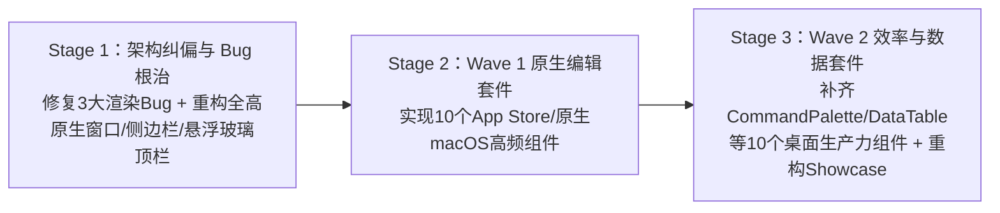

# 🔍 `FluidMacUI` 深度视觉复盘：与原生 macOS 差距根因分析 & 缺失组件全景评估

> **核心结论**：当前 v1.0 跑出了完整的组件骨架与动效逻辑，但从实机截图（图 1、图 2）对比原生 macOS 26/27 App Store（图 3）来看，我们落入了**“Web 暗色仪表盘 + iOS Settings 拼贴”**的误区，距离真正的 **Apple 第一方原生 macOS 质感与布局规范** 存在 **3 个显性渲染 Bug**、**5 个整体布局架构差异**，以及 **20 个生产级高频组件缺口**。

---

## 一、 截图实测发现的 3 个显性 Bug（必须优先根治）

| # | 现象（对应截图位置） | 精确代码根因 | 修复方案 |
| :---: | :--- | :--- | :--- |
| **Bug 1** | **图 1：`FMNavigationStack` 推入二级页面完全透底**，根页面文字与卡片直接穿透显示在二级页背后 | [FMNavigationStack.swift](file:///Users/ly/Documents/deepseek%20projects/FluidMacUI/Sources/FluidMacUI/04_Navigation/FMNavigationStack.swift) 中 `pageSurface` 未填充不透明页面画布底色，导致新页面叠在旧页面上方时透明串层 | 为每个路由页面赋予干净的不透明画布底色（`FMColor.canvasBackground`），仅顶部悬浮工具栏保持通透 |
| **Bug 2** | **图 2：右上角「骨架屏占位」开关出现系统原生硬朗矩形蓝框** | [FMToggleStyle.swift](file:///Users/ly/Documents/deepseek%20projects/FluidMacUI/Sources/FluidMacUI/02_Controls/FMToggleStyle.swift) 中 `.fmFocusRing(...)`（内含 `.focusEffectDisabled()`）写在了 `.focusable(isEnabled)` **之前**，导致 `.focusable()` 重新激活了 AppKit 原生矩形焦点框 | 统一调整所有自定义控件的修饰符顺序：先 `.focusable()` + `.focused()`，最后挂载 `.focusEffectDisabled()` 与自定义胶囊/圆角焦点光环 |
| **Bug 3** | **图 2：详情区向上滚动时，顶部卡片被标题栏“一刀切”硬裁断** | [FMNavigationStack.swift](file:///Users/ly/Documents/deepseek%20projects/FluidMacUI/Sources/FluidMacUI/04_Navigation/FMNavigationStack.swift) 采用 `VStack { header; ZStack.clipped() }` 刚性上下切分，内容区无法滚入透明顶栏下方 | 改用 **全高滚动画布 + 顶部悬浮 Liquid Glass 导航栏**，配合 macOS 26 原生 `.scrollEdgeEffectStyle(.soft, for: .top)` 与顶部安全内边距，实现内容从顶部柔焦隐去的原生观感 |

---

## 二、 与 Apple 原生 macOS（图 3）的 5 大核心布局与美学差距

对比图 1/图 2 与图 3（原生 App Store），真正拉开“原生苹果味”与“第三方拼装感”差距的，是以下 5 个根本性的设计架构差异：

### 差距 1：窗口整体 Chrome 与交通灯（Traffic Lights）归属感错位
* **图 1/2 现状**：左上角红黄绿交通灯孤零零悬在侧边栏上方的暗色空洞里，侧边栏硬生生向下退让 `38pt`，造成顶部一整条无意义的“空额头”。
* **图 3 原生范式**：侧边栏**贯通窗口全高（Full-Height Sidebar）**，红黄绿交通灯自然“长”在侧边栏左上角内部；紧接其下是内置侧边栏搜索框（`Q Search`）；右侧详情区顶部的圆形玻璃返回键 `<` 与分享/操作键 `↑` 与交通灯**保持同一条水平基线**。

### 差距 2：侧边栏视觉过重（把 iOS Settings 图标搬进了 macOS Sidebar）
* **图 1/2 现状**：侧边栏每个导航项都贴了高饱和实心彩色方底图标（`FMIconBadge`）+ 刺眼饱和蓝选中底块 + 亮蓝角标，视觉噪音极大；底部塞满按钮、版本号、快捷键帽，显得拥挤。
* **图 3 原生范式**：
  * 侧边栏图标是**克制的 SF Symbols 线框/纯色图标**（如蓝青色主题图标），无厚重方块底座；
  * 选中态是**温和克制的半透明中性灰/石墨色圆角胶囊**（`Updates` 行），未选中文字柔和，数字角标是低饱和灰底胶囊（`4`），**绝不抢占右侧主内容区的视觉焦点**；
  * 底部是极简的单行账号/状态锚点（`头像 + 名称`）。

### 差距 3：详情页陷入“卡片套卡片（Card Soup）”与“泥泞背景”陷阱
* **图 1/2 现状**：
  * `FMWindowContainer` 默认在全窗口铺设偏蓝紫的 `ambientMesh` 迷雾渐变，导致深色模式下整体显得发灰、浑浊、对比度偏低；
  * 页面里几乎所有内容都被装进了带灰色外边框的 `FMGlassCard` 盒子里，边框四处可见，像网页后台管理系统而非原生 macOS App。
* **图 3 原生范式**：
  * 详情画布极其**干净纯粹**——深色模式是沉稳纯净的深炭黑（`#1C1C1E` / `#1E1E1E`），浅色模式是通透纯白（`#FFFFFF`），与左侧较暗/毛玻璃的侧边栏形成清晰的一级纵深分界；
  * 内容**直接呼吸在画布上**，通过**字号/字重层级 + 0.5pt 极细水平分割线 + 留白节奏**建立秩序（例如图 3 的 Hero 头区 → 竖线分隔的横向指标条 → `Also Included In` → `What's New` → `Preview` 横向画廊）；
  * **玻璃材质（Liquid Glass）只用在“漂浮于内容之上的操控层”**（侧边栏、悬浮圆形工具栏按钮、悬浮 Tab 胶囊、弹窗、灵动岛 HUD），**不滥用在静止正文卡片上**。

### 差距 4：导航栏与工具栏形态过时
* **图 1/2 现状**：返回按钮是一个大块蓝底带文字胶囊 `< 容器与视差导航`，占据顶部大量宽度；顶部常驻两行大标题 + 副标题占用高度。
* **图 3 原生范式**：macOS 26 的标志性特征是**悬浮圆形 Liquid Glass 工具栏按钮**（`32~34pt` 正圆玻璃按钮 `<`、`>`、`↑`、`⋯`）及胶囊按钮组（`GlassEffectContainer` 组合），默认不额外占高，仅在页面滚动后于顶栏中央平滑淡入紧凑页面标题。

### 差距 5：微交互与视觉精度细节
* 实心边框过重：图 1/2 卡片四周 `0.5pt` 白线在深色下显生硬；原生 macOS 靠**柔和表面亮度差 + 顶部极微弱高光边**呈现层次。
* 信息密度与留白比例：图 3 的主按钮（蓝色 `Update` 胶囊）采用**紧凑精致的胶囊尺寸**（高 ~28–30pt，左右留白充足），而非图 2 里又高又方的厚重矩形按钮。

---

## 三、 深度盘点：构建 Apple 原生级 macOS App 还缺少哪些 UI 组件？

对照 **图 3（App Store）** 及 Apple 全家桶原生应用（Finder、系统设置、音乐、照片、备忘录、Keynote、Xcode、活动监视器），我们盘点出当前 `FluidMacUI` 缺失的 **20 个高价值组件**，分为 4 大类与 2 个实施波次（Wave 1 原生布局核心 / Wave 2 桌面生产力进阶）：

### 波次 1（Wave 1 — 达成图 3 级原生观感的核心必备，10 个）

| # | 组件名称 | 对标原生 macOS 场景 | 核心功能与体验定位 |
| :---: | :--- | :--- | :--- |
| 01 | **`FMToolbar` / `FMToolbarButton` / `FMToolbarGroup`** | 图 3 顶部 `<`、`↑` 悬浮玻璃圆钮 & macOS 26 胶囊工具栏 | 与交通灯齐平的悬浮圆形/胶囊 Liquid Glass 按钮组，支持 `GlassEffectContainer` 流体融合、快捷键与 `FMTooltip` |
| 02 | **`FMSidebarSearchField` & `FMSidebarAccountFooter`** | 图 3 侧边栏顶部搜索框 & 底部账号条 | 原生融入全高侧边栏顶部的胶囊搜索框（自动避让交通灯）+ 底部头像/状态栏锚点 |
| 03 | **`FMHeroHeader`** | 图 3 Keynote 大图标头区 | 详情页标准头区：大圆角图标/封面 + 标题/副标题 + 紧凑胶囊主操作按钮 + 次级操作 |
| 04 | **`FMMetricStrip`** | 图 3 `9.3K RATINGS / 4+ / Productivity / 1.03 GB` 指标栏 | 横向等距或滚动的多列 KPI 摘要条，内置竖向 0.5pt 分割线、星级/图标/大数字与上下标文案 |
| 05 | **`FMSectionHeader` & `FMHairlineDivider`** | 图 3 `What's New` + `Version History` | 无卡片边框的编辑式分区头（左标题 + 右链接/操作按钮）与原生极细分割线，彻底告别“卡片汤” |
| 06 | **`FMExpandableText`** | 图 3 `What's New` 折叠文案 + `more` | 多行文本自动行数截断 + 内联主题色 `展开更多 / 收起` 弹簧过渡 |
| 07 | **`FMHorizontalCarousel`** | 图 3 底部 `Preview` 横向画廊 | 支持平滑横滚吸附、右缘内容探出预览（Peek），以及**鼠标悬停自动浮现左右玻璃翻页圆钮**（照顾无触控板鼠标用户） |
| 08 | **`FMRatingView`** | 图 3 `4.7 ★★★★★` | 精确支持半星/小数展示的星级视图，同时支持交互式拖动打分 |
| 09 | **`FMAvatar` & `FMAvatarGroup`** | 图 3 左下角头像 / 协作头像栈 | 圆形头像（图片/文字首字母渐变回退 + 在线圆点）及重叠头像组 |
| 10 | **`FMInspectorSplitView`** | Xcode / Pages / Photos 右侧检查器三栏 | 原生 **Sidebar + Main Canvas + Collapsible Inspector** 标准三栏窗口架构，支持可拖拽调宽与平滑折叠 |

### 波次 2（Wave 2 — 现代 macOS 效率与数据类 App 完整闭环，10 个）

| # | 组件名称 | 对标原生 macOS 场景 | 核心功能与体验定位 |
| :---: | :--- | :--- | :--- |
| 11 | **`FMCommandPalette`** | Spotlight / Linear / Raycast `⌘K` | 窗口级居中悬浮 Liquid Glass 命令面板，支持模糊搜索、分组命令、键盘上下选择与 `FMKeycap` 展示 |
| 12 | **`FMDataTable`** | Finder 列表 / 活动监视器 / 邮件 | 流体多列数据表格：列头排序、整行 Hover 高亮、单选/多选（`⌘`/`⇧`）、极细行分割线与右键菜单 |
| 13 | **`FMBreadcrumbBar`** | Finder / 文档目录路径条 | 可点击层级面包屑导航条，支持路径过长自动折叠与点击跳转 |
| 14 | **`FMFilterChips` & `FMTokenField`** | Mail / Photos 筛选胶囊与标签输入 | 可单选/多选的横向筛选胶囊组 + 输入回车自动转化为可删胶囊的标签输入框 |
| 15 | **`FMFileDropZone`** | macOS 桌面文件拖放区 | 支持 Finder 文件拖入高亮、动态虚线描边、吸附缩放反馈与已选文件回显 |
| 16 | **`FMInlineBanner`（Callout）** | 系统设置 / App Store 内嵌提示条 | 页面内嵌的信息/成功/警告/错误横幅（带图标、文案、内联动作与关闭按钮） |
| 17 | **`FMConfirmPopover`** | macOS 轻量级就地二次确认 | 锚定在触发按钮旁的玻璃确认气泡（如删除确认），比全屏居中 Alert 更克制不打断心流 |
| 18 | **`FMSelectionActionBar`** | Photos / Files 多选悬浮批量操作条 | 多选态下从底部弹性浮出的玻璃胶囊栏（显示“已选 N 项” + 批量导出/移动/删除） |
| 19 | **`FMDatePicker` & `FMColorSwatches`** | 日历/提醒事项现代选择器 | 无丑陋 AppKit 外框的圆角日期/时间弹窗选择器与预设色板+自定义取色器 |
| 20 | **`FMLightbox`** | Photos / App Store 截图大图预览 | 点击画廊图片居中缩放展开预览、支持键盘 `←`/`→` 切换与 `Esc` 关闭 |

---

## 四、 `FluidMacUI` v3.0「Apple Native 对齐」升级方案

为了让基于 `FluidMacUI` 开发的任意 macOS App 都能**开箱即得图 3 级别的 Apple 第一方原生观感**，同时保留 iOS 的物理弹性与 macOS 满血能力，规划分 3 个阶段完成升级：

### Stage 1：根治 3 大渲染 Bug + 重构 Apple Native 窗口与导航架构
1. **修复 3 个实测 Bug**：
   - `FMNavigationStack`：为页面栈补齐不透明画布底色，彻底消除推入透底；内容区采用全高滚动 + `.scrollEdgeEffectStyle(.soft, for: .top)` 顶部柔焦过渡，消除硬裁切。
   - `FMToggleStyle` / `FMCheckboxStyle` / `FMSlider` / `FMSegmentedPicker` / `FMButtonStyle`：全库审计 `.focusEffectDisabled()` 顺序，彻底杜绝原生矩形蓝框泄漏。
2. **重塑原生 macOS 窗口与侧边栏范式**：
   - `FMWindowContainer` 默认背景切换为纯净原生画布（`.nativeCanvas`：深色 `#1C1C1E` / 浅色 `#FFFFFF`），保留 `.ambientMesh` 作为可选氛围模式。
   - `FMSidebarSplitView` 升级为 **Apple 原生全高侧边栏**（支持 `.fullHeight` 原生模式与 `.floating` 悬浮模式切换）：红黄绿交通灯内置于侧边栏左上角、内置可选 `FMSidebarSearchField`、侧边栏图标支持原生精致单色/双色 SF Symbol 样式与温和中性灰选中胶囊、底部内置 `FMSidebarAccountFooter`。
   - `FMNavigationStack` 顶部导航栏升级为 **与交通灯水平对齐的悬浮 Liquid Glass 圆形返回键 `<` + 右侧圆形工具栏按钮组**，滚动后顶栏柔和浮现居中/内联标题。

### Stage 2：落地 Wave 1（10 个原生编辑与布局组件）
- 实现 `FMToolbar`（含 `FMToolbarButton`、`FMToolbarGroup`）、`FMHeroHeader`、`FMMetricStrip`、`FMSectionHeader`、`FMHairlineDivider`、`FMExpandableText`、`FMHorizontalCarousel`、`FMRatingView`、`FMAvatar` / `FMAvatarGroup`、`FMInspectorSplitView`。
- **Showcase 标杆演示页**：新增一个 **1:1 复刻图 3 原生 App Store / 详情页** 的真实应用样板页（展示全高侧边栏 + 搜索 + 悬浮 `<` / `↑` 玻璃圆钮 + Hero 头区 + 横向指标条 + 折叠更新日志 + 横向 Preview 画廊 + 右侧可折叠检查器），用真实效果自证与 Apple 第一方 App 视觉齐平！

### Stage 3：落地 Wave 2（10 个桌面生产力与数据组件）+ 测试与文档补全
- 实现 `FMCommandPalette`（`⌘K`）、`FMDataTable`、`FMBreadcrumbBar`、`FMFilterChips` / `FMTokenField`、`FMFileDropZone`、`FMInlineBanner`、`FMConfirmPopover`、`FMSelectionActionBar`、`FMDatePicker` / `FMColorSwatches`、`FMLightbox`。
- 补充全部新状态机的 `Swift Testing` 单元测试，确保全库 0 警告编译与全测试通过。

---

## 五、 待您确认的推进选项

请审阅上述诊断与升级方案，确认后我将立即按阶段落地编码与验证：

1. **执行范围**：是否一次性按 **Stage 1 → Stage 2 → Stage 3** 完整落地（共修复 3 个实测 Bug + 重构原生布局架构 + 新增全部 20 个缺失组件 + 打造图 3 级原生 App Store 样板页），还是先完成 **Stage 1 + Stage 2** 让您实机截图验收整体质感后再推进 Stage 3？
2. **侧边栏默认风格**：是否将 `FMSidebarSplitView` 默认风格调整为 **图 3 同款全高原生 macOS 侧边栏（含交通灯融合 + 搜索框 + 简洁 SF Symbol 图标 + 柔和中性选中态）**，并将原来的悬浮圆角侧边栏保留为 `.style(.floating)` 可选样式？
